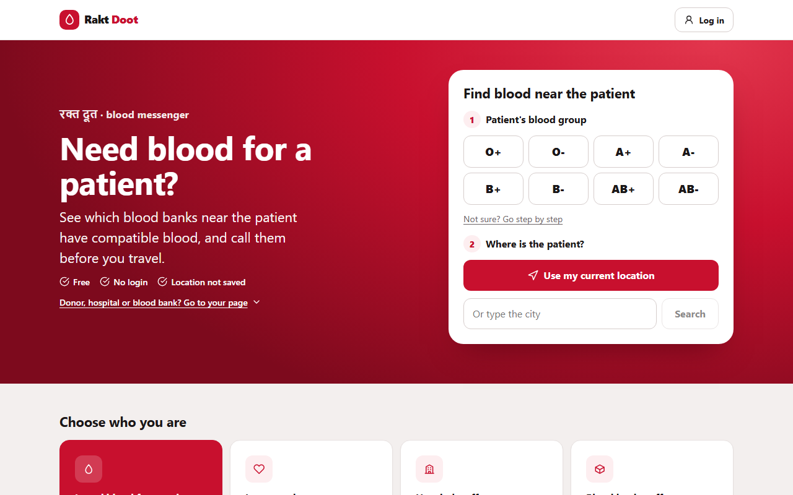
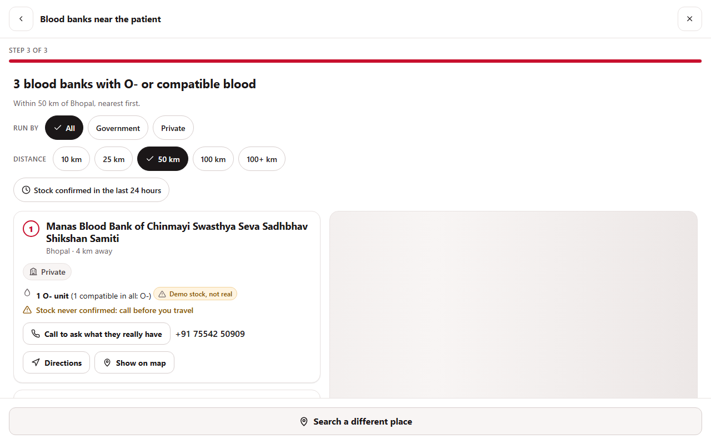
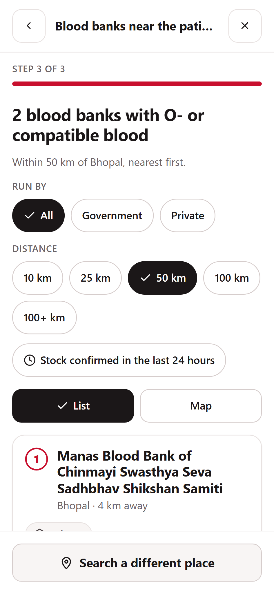
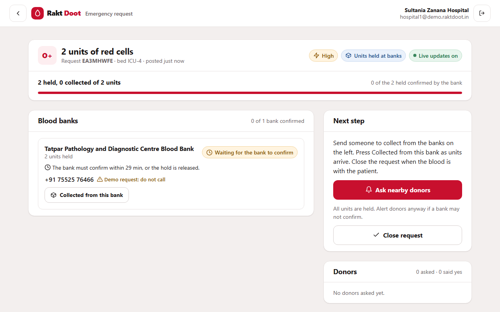
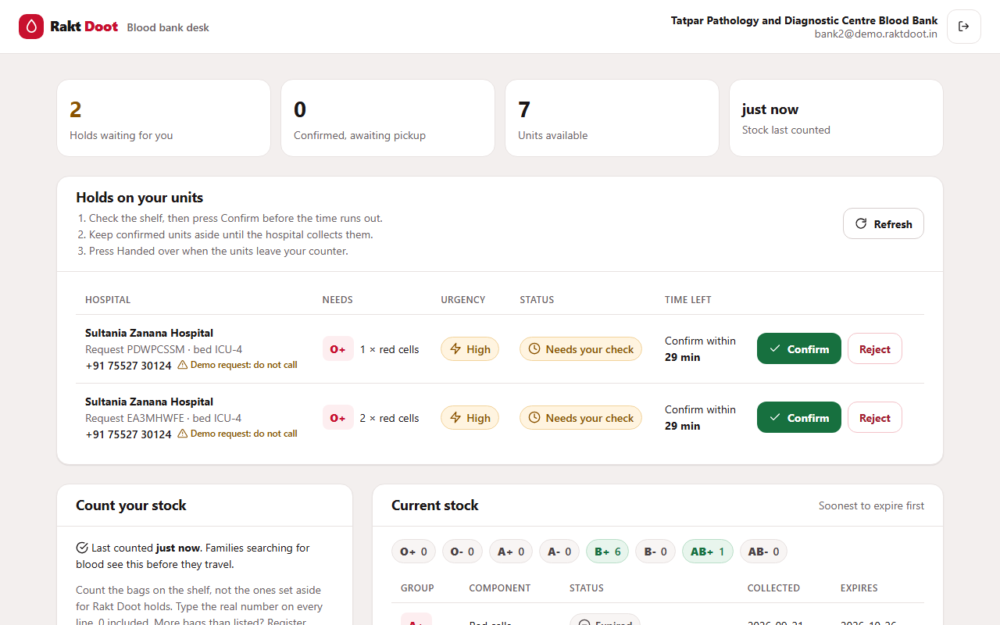

# Rakt Doot (रक्त दूत, "blood messenger")

[](https://github.com/AnshulSinglaa/RaktDoot/actions/workflows/ci.yml)

**India's blood shortage is mostly a distribution problem.** The country collected 14.6 million units in 2024-25 against
a stated need of 14.6 million, but that need comes from a 2018 study of the 2017 population, and independent estimates
put the real gap near 1 million units a year. Averages hide where the blood is: a 2024 study of eight northern states
(660 million people, including Madhya Pradesh) found only about 61% of people within an hour of a blood-equipped
facility, and named the rest **"blood deserts"** ([BMJ Global Health 2024](https://www.ncbi.nlm.nih.gov/pmc/articles/PMC11499795/);
all sources in [docs/DATA-SOURCES.md](docs/DATA-SOURCES.md)).

**What Rakt Doot does:**
1. A family finds the nearest blood banks that really hold compatible blood, on a map of real MP facilities, with no login.
2. A hospital posts an emergency; the system places holds on compatible units at the nearest banks in one transaction,
   and each bank confirms the unit is on its shelf.
3. If stock is short, nearby eligible donors are alerted, and the hospital watches every hold and reply update live.

Python 3.12 · FastAPI · PostgreSQL 16 + PostGIS · SQLAlchemy 2 (async) · Alembic · Next.js 16 · React 19 · TypeScript ·
Leaflet · Docker Compose · GitHub Actions · pytest · k6

---

## Who uses it

| Role | What they do | Page |
|---|---|---|
| Patient / family | Pick a blood group and a city (or "use my location"), see the nearest banks with compatible stock, call them | `/find` (no login) |
| Donor | Register with consent, set availability, see alerts, answer "I can donate" / "I can't" | `/login`, `/donor` |
| Hospital staff | Post an emergency (group, component, units, urgency), follow holds and donor replies live, mark blood collected, close | `/hospital`, `/hospital/requests/[id]` |
| Blood bank staff | Confirm or release holds, hand units over, count the shelf (stock-take) | `/bank` |
| Admin | Onboard facilities and staff accounts, read the donor list | API only, `http://localhost:8000/docs` |

## How it works: a 90-second demo

`seed-demo` creates these accounts on the real Bhopal facilities: `hospital1@`, `hospital2@`, `bank1@`, `bank2@`,
`bank3@`, `donor@` and `admin@demo.raktdoot.in`. They all share one password, generated on your machine and written to
the gitignored `Backend/demo-credentials.txt` (see [Run it locally](#run-it-locally)). The README never contains it.

1. **Find blood** (`/find`, no login): choose *B+*, *Bhopal*. You get a numbered list and a map of real MP blood banks
   with compatible stock, nearest first, each tagged with who runs it, how fresh its count is, and "Demo stock, not real".
2. **Post a request:** log in as `hospital1@` → `/hospital` → *AB-, red cells, 3 units, critical*. Holds land at the
   nearest onboarded banks at once: `bank1@`'s bank auto-confirms; the others show **PENDING** with a 30-minute deadline.
3. **Bank confirms:** in a second browser, log in as `bank2@` → `/bank` → **Confirm**. The hospital page flips to
   *CONFIRMED, collect within 6 hours* without a reload.
4. **Live status:** the hospital presses **Ask nearby donors**; alerted donors appear as *notified*. Log in as `donor@`
   → *I can donate* → the hospital sees *accepted*, live.
5. **Stock count:** as a bank, enter the shelf count on `/bank`; `/find` now shows that bank's new count, "confirmed just now".

Edge cases worth trying: cancel is refused once any unit was collected (that blood is in a patient); `hospital2@` shows
that banks with no staff account are skipped by allocation but still listed for families to phone.

## Screenshots

| | |
|---|---|
|  |  |
|  |  |
|  | |

## The hard problems, and how they are solved

| Problem | Solution | ADR |
|---|---|---|
| Two hospitals must never get the same unit | `SELECT … FOR UPDATE SKIP LOCKED` (first-expiring first) plus a partial unique index allowing one live allocation per unit. With the lock removed, the concurrency test fails on the index: the race is real and the backstop catches it | [016](docs/adr/016-allocation.md) |
| Donor alerts must not be lost or sent twice | Transactional outbox: the message is written in the same transaction as the request; a worker drains it with `SKIP LOCKED`, backoff and a dead-letter state; the handler is idempotent | [017](docs/adr/017-outbox.md) |
| Live status without polling or Redis | Server-Sent Events fed by Postgres `LISTEN/NOTIFY`, which fires only on COMMIT; streams hold no pooled connection | [018](docs/adr/018-live-status.md) |
| A hold must match a real shelf and must not last forever | Holds are PENDING until the bank confirms (30 min), CONFIRMED until pickup (6 h), then released by a worker with one conditional `UPDATE`; per-hospital cap under an advisory lock. Collected blood is ISSUED for good: no cancel, expiry or release returns it to stock (a CHECK constraint backs this) | [021](docs/adr/021-bank-confirmed-holds.md), [023](docs/adr/023-stock-take.md) |
| A bug in the app must not erase history | The app connects as a least-privilege role: no DELETE on the audit log, no DDL, no trigger changes. Migrations run as the owner | [014](docs/adr/014-least-privilege-db-role.md) |
| Stolen tokens | argon2id passwords, 15-minute JWTs with the algorithm pinned, rotating refresh tokens in HttpOnly SameSite=Strict cookies, reuse of an old refresh token revokes the whole family; lockout and one generic login error | [013](docs/adr/013-authentication.md) |
| Health data (DPDP Act 2023) | Public search shows donor **counts only**, with any count below 5 hidden; locations rounded by the server; hospitals see first name, group and distance band; every donor lookup is audited in an append-only log written in the same transaction | [010](docs/adr/010-audit-log-in-postgres.md), [015](docs/adr/015-geo-matching.md), [020](docs/adr/020-donor-safety.md) |
| Realistic data without faking reality | Real OpenStreetMap hospitals and blood banks of MP; stock, donors and requests are synthetic and flagged (`stock_is_demo`) in the API and UI | [022](docs/adr/022-osm-facilities.md) |

Other decisions: [011 modular monolith layout](docs/adr/011-module-layout.md), [019 load test](docs/adr/019-load-test.md),
[024 Leaflet map](docs/adr/024-leaflet-map.md), and the rest in [docs/adr](docs/adr). Full diagrams and failure analysis:
[docs/ARCHITECTURE.md](docs/ARCHITECTURE.md).

```
 Next.js (find / hospital / bank / donor) --HTTP + SSE--> FastAPI x4 workers --asyncpg, least-privilege role--> Postgres + PostGIS
                                                               ^                                                    |
                                                               +------------------- LISTEN/NOTIFY ------------------+
                                                outbox worker --FOR UPDATE SKIP LOCKED--> outbox table --> donor inbox
```

## Measured, not claimed

| What | Result |
|---|---|
| Test suite | 489 backend tests pass (pytest, real PostGIS), ruff clean |
| Coverage | 95% (backend) |
| End-to-end | Playwright click-through of the family, hospital and bank journeys at 1280 px and 360 px (`cd frontend && npm run e2e`) |
| Load (k6, full emergency lifecycle) | 429 req/s, 0 errors in 13,256 requests at 40 virtual users; create p95 missed its SLO by 6 ms and that is recorded ([ADR 019](docs/adr/019-load-test.md)) |
| Nearest donors, 200,000 rows | 9.3 ms with the GiST index vs 234 ms without ([ADR 015](docs/adr/015-geo-matching.md)) |

## Deliberately not built

- **No ML yet.** There is no labelled data on day one. Matching is a deterministic score (compatibility, distance,
  eligibility, availability), and donor replies are logged so a response-probability model can be trained on real
  outcomes later. A model trained on synthetic data would be a fake.
- **No platelets, and no change to the allocation policy,** until a blood-centre medical officer signs off. Requests are
  red cells or plasma only.
- **No SMS.** Donors are reached through the in-app inbox; phones are verified in person by bank staff.
- **No public live demo.** Real facility phone numbers sit next to synthetic stock; a public site would send real calls
  to banks about blood that does not exist.
- **No Kafka, Kubernetes or Redis** until a measurement says Postgres is not enough. The outbox gives reliability;
  `LISTEN/NOTIFY` gives live updates; the login rate limiter is per worker for now, and account lockout is the real control.

## Run it locally

Prerequisites: Docker Desktop (Compose v2), Git. For the demo password file and the tests: Python 3.12.

```bash
git clone https://github.com/AnshulSinglaa/RaktDoot.git && cd RaktDoot
cp .env.example .env          # set POSTGRES_PASSWORD, APP_DB_PASSWORD and a 32+ character JWT_SECRET
docker compose up --build -d  # db, migrate (one-shot: schema to head), api, worker, web
docker compose exec api python manage.py import-osm   # real MP hospitals and blood banks; safe to re-run
```

`migrate` runs automatically before the API starts; re-run it with `docker compose run --rm migrate`.

**Demo data.** The API container runs as a non-root user that cannot write files, so generate the password on the host:

```bash
cd Backend
python -m venv .venv && source .venv/bin/activate     # Windows: .venv\Scripts\activate
pip install -r requirements.txt
cp .env.example .env    # LIFELINK_DATABASE_URL=postgresql://lifelink:<POSTGRES_PASSWORD>@localhost:5434/lifelink
                        # and a 32+ character LIFELINK_JWT_SECRET
python manage.py seed-demo                            # writes Backend/demo-credentials.txt (gitignored)
```

Or stay inside Docker and choose the password yourself (it is never printed):
`docker compose exec -e LIFELINK_DEMO_PASSWORD=<your-password> api python manage.py seed-demo`.

Open http://localhost:3000. API docs: http://localhost:8000/docs.

**Tests** (needs the `db` service, or Docker for testcontainers): `cd Backend && pip install -r requirements-dev.txt && python -m pytest --cov`.
**Load test:** see the header of `Backend/load/emergency.js`.

## Data and licences

- **Facilities are real:** 118 blood banks and 1,929 hospitals in Madhya Pradesh from OpenStreetMap (largely the
  Ministry of Health's 2017 directory), validated on import with every dropped row counted by reason. Email, website and
  personnel tags are not imported. © [OpenStreetMap contributors](https://www.openstreetmap.org/copyright), available
  under the Open Database License (ODbL 1.0). Map tiles © OpenStreetMap contributors.
- **Everything else is synthetic and labelled:** stock, holds, requests, donors and accounts. Real donor data is personal
  health data and is never used. The app never contacts a facility: the notifier reaches donors only.

## Project structure

```
Backend/              FastAPI app (Python 3.12)
  main.py             app factory, routers mounted under /v1
  modules/            auth, organizations, inventory, emergencies, public: each owns its tables
  migrations/         Alembic, hand-written SQL revisions
  worker.py outbox.py transactional outbox worker
  manage.py           migrate, create-admin, import-osm, seed-demo
  data/osm/           OpenStreetMap snapshots of MP facilities
  load/               k6 scripts
  test_*.py           pytest suite against real Postgres + PostGIS
frontend/             Next.js 16 thin client (all rules live in the API)
docs/                 ARCHITECTURE.md, DATA-SOURCES.md, adr/
infra/postgres/       first-start init (test database)
docker-compose.yml    the whole stack, ports bound to 127.0.0.1
```
